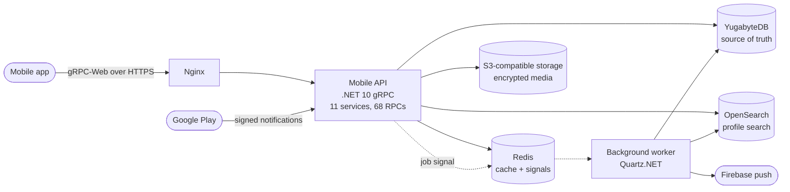

# Case study: backend for a production matchmaking platform

**Role:** Lead architect, owning architecture, backend, infrastructure and deployment
**Period:** 2026 – present
**Stack:** .NET 10, gRPC and gRPC-Web, YugabyteDB (distributed PostgreSQL), OpenSearch, Redis, Quartz.NET, Docker, Nginx, GitHub Actions; React Native client

The product is in production and not open source, so this write-up describes the design and the reasoning behind it, without code. The patterns it relies on are rebuilt from scratch in a public reference repository: [ReliableMessaging](https://github.com/debugger90/ReliableMessaging).

## The problem

A mobile matchmaking app where members create detailed profiles, search for compatible partners by many preferences, keep private photo galleries, and buy subscriptions through Google Play. The backend had to:

- serve **thousands of requests per second** at peak from mobile clients on unreliable networks;
- scale to **10 million profiles** without redesign;
- protect highly personal data: photos, contact details and preferences;
- keep billing correct when one Google account is shared between devices or app accounts.

## Architecture

Two independently deployable .NET solutions share one database and one Redis instance and never call each other directly:

- **Mobile API.** A gRPC service (gRPC-Web for the client) with 68 RPCs across 11 services: authentication, profiles, gallery, search and matching, subscriptions, payments, notifications and support. It stays lightweight: anything slow or cross-cutting is handed to the worker.
- **Background worker.** Runs jobs triggered by events (push notifications, image processing, subscription changes, session updates) and recurring jobs scheduled with Quartz.NET.

## Key decisions

### Distributed SQL rather than sharding by hand

At 10 million profiles with heavy read and search traffic, a single PostgreSQL instance would eventually need manual sharding. I chose YugabyteDB, which speaks the PostgreSQL wire protocol, so the code uses ordinary Npgsql and Dapper while the database scales horizontally.

Data access is Dapper-first, with one rule enforced in review: one database round trip per request wherever possible. Lookups are combined with joins, CTEs and `ANY(@ids)` batch parameters, instead of sequential queries or queries in loops. In a distributed database each round trip costs more than on a single node, so this mattered more than usual.

### Search in OpenSearch, truth in the database

Partner search filters on many optional criteria at once and ranks the results, which is a poor fit for relational indexes at this size. Profiles are indexed into OpenSearch for search and matching. The database stays the source of truth, and the index is kept in step from it. An `any` sentinel value for unset filters keeps query building uniform, instead of null checks scattered through the code.

### Database as source of truth for background jobs, Redis as the doorbell

The API publishes a job event on Redis pub/sub. The worker reacts immediately, but records every job's state, retries and history in the database. Redis pub/sub can drop messages, so it is never trusted as a queue. It only reduces latency, and nothing is lost if Redis restarts. The same pattern is implemented and tested in the public reference repository.

### gRPC with an encrypted message envelope

Every request and response travels in an envelope encrypted with AES-GCM, using keys agreed through an ECDH key exchange, on top of TLS. Captured traffic is therefore unreadable even where TLS is intercepted on a device. Authentication, rate limiting and error handling sit in one server interceptor. Business code does not catch exceptions just to translate them, which keeps every service consistent.

### Private media by design

Uploads are decoded only from an allow-list of image formats, converted to WebP, encrypted and stored in S3-compatible storage. Private galleries are encrypted with per-user keys, and access is granted per member and revoked through version-checked updates, so a cancelled grant cannot be resurrected by a stale write.

### Billing that holds up when accounts are shared

Subscriptions use Google Play Billing with server-side verification of every purchase. Each purchase token is bound to exactly one account, and the account id Google records is an opaque server-generated value, never personal data. Google's signed real-time notifications drive renewals and cancellations. As a result, one member cannot be billed for, or cancel, another member's plan when a Google account is shared.

## Performance and cost

- **Compact cache format.** Redis values are stored as versioned, positional JSON arrays with short hashed keys. This cuts memory use without changing a single API response. A version number in every value lets the layout evolve safely.
- **Delta sync for reference data.** Countries, cities and dropdown lists carry version numbers, so the app downloads only what changed.
- **Async everywhere.** There is no sync-over-async in the data or service layers, which keeps thread-pool use predictable under load.

## Security

I ran a structured security review of the API and worker. It traced every request path from the app through the database, cache, search index, worker and storage, and produced 27 findings, each with a severity, a fix and a way to verify it. Most are fixed and tested, including all high-severity issues in the application code; the rest are infrastructure and configuration items tracked to completion. Controls that came out of it:

- Session tokens are bound to the device session they were issued to, and are revoked on sign-out, account deactivation and deletion.
- New gRPC services require authentication by default; anonymous access must be declared explicitly.
- Payment webhooks must carry a valid Google signature and are size-limited before anything is stored.
- Rate limits and a bot guard stop profile scraping and protect the Google Play API quota.
- Account deletion erases personal data through a worker job.

## Delivery

- Docker images behind Nginx, deployed through a GitHub Actions pipeline.
- 121 automated tests across the API and worker.
- The work used AI coding agents (Claude Code) under written engineering rules: async-only I/O, single round trips, centralised error handling and no brand names in identifiers. I reviewed every change as architect. Written handoff documents and contracts between backend, mobile and admin portal kept three codebases in step.

## What I would do next

- Move background jobs to a transactional outbox, so a job is written in the same transaction as the change that causes it. The [reference repository](https://github.com/debugger90/ReliableMessaging) shows the approach.
- Add OpenTelemetry tracing from the gRPC call to the worker and to OpenSearch, with alerts on job age and failure rate.
- Replace the remaining manual schema steps with versioned migrations.
